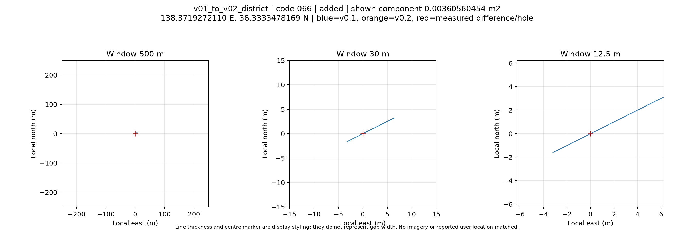
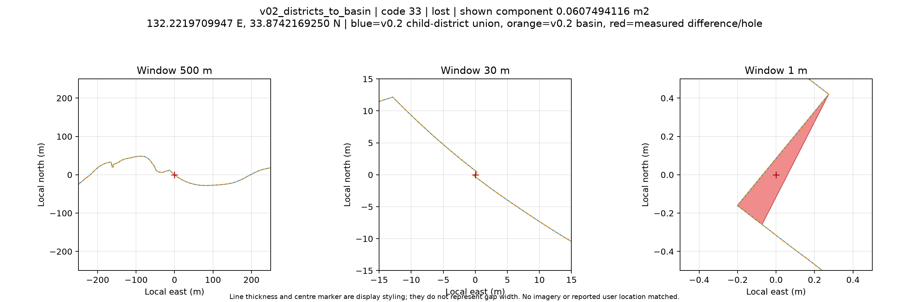

# 確認用森林データの集約・微小隙間の検証（2026-10-13）

公開v0.1・v0.2と元の公開市町村版を読み取り専用で比較しました。処理・対応表・公開データ・既存Releaseは変更していません。現行の公式所属や境界を確定する検証ではありません。

## 入力と方法

森林Release review-v0.1-20261005、review-v0.2-20261010の森林ZIP・市町村候補ZIPと、派生元v2026.1の市町村版を使用しました。[input-manifest.json](input-manifest.json)にZIPの版・URL・実測SHA-256を記録しています。

利用者提供の `forest_planning_zones_2026_review (1).zip` は358,220,950 bytes、SHA-256 `61411ba087d26c97aad346d4363e8470e7168b47e4c95e15da66307d61b6b17b` で、公開v0.2 ZIPと一致しました。利用者が別途行った補修との同一性を示す結果ではありません。

座標系はEPSG:6668（JGD2011経緯度）、座標許容幅0です。面積による合否閾値、スナップ・丸め・拡張・形状修復・一律の湖面除外は行っていません。正規化座標が完全一致すれば領域一致と判定し、それ以外では双方向差分を計算します。面積はGRS80測地面積で報告し、穴にはReleaseの判定方式（半径6371008.8mの球による円筒等積）の値も記録しています。

## 再集約と補修差分

| 比較 | 対象 | 双方向差分が空 | 非空 | 期待側のみ㎡ | 実データ側のみ㎡ |
|---|---:|---:|---:|---:|---:|
| 市町村から再集約→v0.1計画区 | 158 | 158 | 0 | 0 | 0 |
| 市町村から再集約→v0.1広域流域 | 44 | 44 | 0 | 0 | 0 |
| v0.1→v0.2計画区 | 158 | 126 | 32 | 0 | 0.02242673291 |
| v0.1→v0.2広域流域 | 44 | 27 | 17 | 0 | 0.02361702486 |
| v0.1→v0.2未割当 | 20 | 20 | 0 | 0 | 0 |
| v0.2計画区の再集約→v0.2広域流域 | 44 | 29 | 15 | 0.06080087987 | 0.00323369063 |

元の公開市町村版と両版の市町村候補は、全1,911地物で領域一致しました。再集約は公開候補の森林計画区・広域流域属性を使用しました。[forest-comparison.csv](forest-comparison.csv)に全件を保存しています。期待側・実データ側は計算方向であり、即座に物理的な欠落・追加を意味しません。

## 穴・外周・未割当

| レイヤ | v0.1内部リング | 除去 | v0.2内部リング | 1㎡未満の残存 |
|---|---:|---:|---:|---:|
| 計画区 | 1,485 | 1,469 | 16 | 0 |
| 広域流域 | 1,639 | 1,623 | 16 | 0 |
| 未割当 | 3 | 0 | 3 | 0 |

外周座標のバイト列は全件保持され、追加された内部リングは0個でした。全リングの2種類の面積と閾値判定は[hole-inventory.csv](hole-inventory.csv)にあります。

説明にある「9件」は総リング数ではありません。保持された各レイヤ16個の穴を全公開市町村との交差で検査すると、市町村に正の面積で覆われない9個と、別区域に覆われる7個に分かれました。計画区の別区域7個は別割当4個＋未割当3個、広域流域では別割当2個＋未割当5個を代表点・コードで確認しました。別区域の穴を取り込まず、湖面も一律除外していません。

v0.1にも微小な区域間交差があり、計画区31組約0.01045977㎡、広域流域8組約0.00530423㎡で、v0.2でも同数・同面積でした。未割当13000との交差も両版に約0.000018865㎡あり、計算残差を含み得るため実際の侵入とは断定しません。補修による**追加領域**と未割当20区域の交差は0件でした。



図の線幅・マーカーは実際の隙間幅ではありません。

## 階層間の整合と原因判定

補修後の計画区を流域別に再集約すると、15/44流域に非空差分が残りました。計画区内部の穴埋めと、広域流域内部の穴埋めは同じ結果を保証しません。

最大約0.06074941㎡の流域33の演算残差は、補修前v0.1にも存在し、代表点は元の公開市町村35305・計画区113・両版の流域33・計画区集約形状に含まれました。Shapely 2.2.0 / GEOS 3.14.1でも再現しました。補修による新規欠落と断定しません。

流域21の別サンプルでは、代表点がv0.2広域流域に含まれ、v0.2の構成計画区には含まれないという包含差を確認しました。全差分を同じ原因と判断していません。[representative-point-evidence.json](representative-point-evidence.json)に記録しています。



派生元の全国検証では提供N03と公開市町村版の全1,905コードが正規化座標一致し、高松市の約0.03353㎡だけ差分演算の残差が再現しました。計画区3件・流域3件の補修箇所の代表例（一部同一地点）を提供N03の集約前の地物へ直接照合すると、代表点は原典にも含まれませんでした。少なくともこれらの点の空白は森林集約で新たに欠落させたものではありません。全隙間や利用者の指摘画像に一般化しません。

利用者画像の具体的位置・表示条件は未取得です。「原典由来・加工由来・表示現象」の全指摘箇所での原因確定は未完了です。ArcGIS Proで流域図がテーブル扱いになる問題は別件として未検証です。全件の測定と処理系は[measured-summary.json](measured-summary.json)を参照してください。

## 再実行

Python 3.12を使用し、Release ZIPのSHA-256をinput-manifest.jsonと照合してから各GPKGを展開します。

```bash
python3.12 -m venv .venv
.venv/bin/python -m pip install -r scripts/geometry_audit/requirements.txt
.venv/bin/python scripts/audit_forest_release_geometry.py \
  --municipalities INPUT/plane_rectangular_municipalities_2026.gpkg \
  --candidate-v01 INPUT/v01/municipality_forest_zones_2026_candidate.gpkg \
  --candidate-v02 INPUT/v02/municipality_forest_zones_2026_candidate.gpkg \
  --forest-v01 INPUT/v01/forest_planning_zones_2026_provisional_labeled.gpkg \
  --forest-v02 INPUT/v02/forest_planning_zones_2026_provisional_labeled.gpkg \
  --output output/forest-geometry-audit
```

`INPUT`を実ファイルの場所に置き換え、出力先には未作成の別ディレクトリを指定します。CSV・JSON・差分GeoPackageを生成し、原典を書き換えません。既存Releaseの生成・公開ワークフローは実行しません。

大きな差分GPKG・ZIP・原典はGitに含めていません。検証資料を別途Release添付する場合は、入力版・SHA-256・未確認事項を併記し、既存の配布データとは区別します。データの出典と制約は[DATA_LICENSE.md](../../DATA_LICENSE.md)と[data/forest/README.md](../../data/forest/README.md)を保持します。
