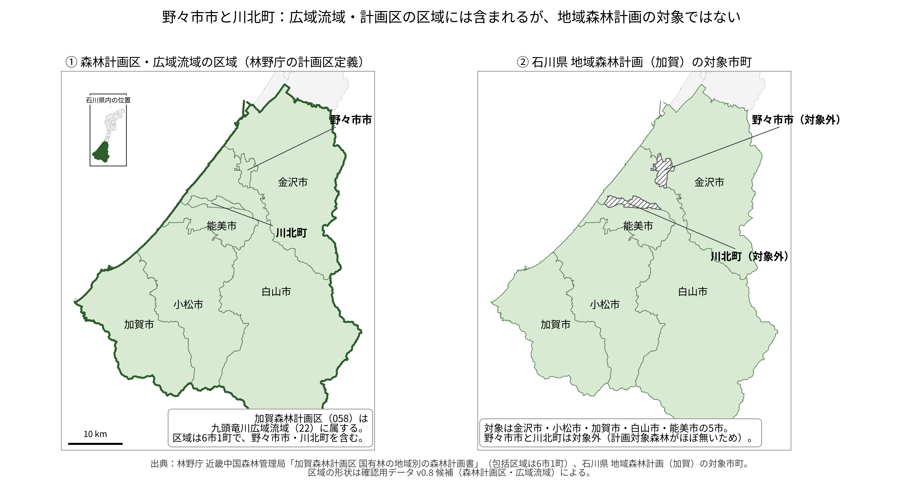
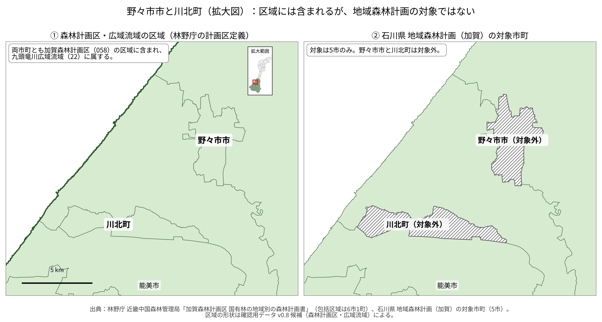

# 未割当13市町村の割当（確認用 v0.8）

確認用 v0.7 の時点で未割当だった20件のうち、市町村全域の13件について、県の地域森林計画などの公式資料で所属を照合し、v0.8 で割り当てました。根拠資料のURLは、市町村データの `forest_source_url` に市町村ごとに記録しています。

| 市町村 | 割当先の計画区 | 広域流域 |
|---|---|---|
| 紗那村（北海道） | 012 釧路根室 | 04 十勝・釧路川 |
| 滝沢市（岩手県） | 021 北上川上流 | 10 北上川 |
| 大網白里市（千葉県） | 046 千葉北部 | 17 利根川 |
| 新島村（東京都） | 049 伊豆諸島 | 17 利根川 |
| 野々市市（石川県） | 058 加賀 | 22 九頭竜川 |
| 穴水町（石川県） | 057 能登 | 22 九頭竜川 |
| 能登町（石川県） | 057 能登 | 22 九頭竜川 |
| 海津市（岐阜県） | 072 揖斐川 | 23 木曽川 |
| あま市（愛知県） | 078 尾張西三河 | 23 木曽川 |
| 長久手市（愛知県） | 078 尾張西三河 | 23 木曽川 |
| 丹波篠山市（兵庫県） | 089 加古川 | 29 加古川 |
| 香美市（高知県） | 126 高知 | 36 吉野・仁淀川 |
| 那珂川市（福岡県） | 129 福岡 | 39 筑後川 |

残る未割当7件は、都道府県レベルの所属未定地（千葉県、東京都、愛知県、和歌山県、福岡県、鹿児島県、沖縄県）です。森林計画区の区域は市町村（郡）単位で定義されるため、市町村に属さない土地は公式資料では特定できず、未割当のままにしています。

## 留保

### 紗那村

全国森林計画の包括区域表（郡単位）では沙那郡が釧路根室に含まれ、他の北方領土の村も従来から同計画区に割り当てています。一方、北海道の地域森林計画の構成リストには、北方領土の町村の記載がありません。

### 野々市市と川北町

広域流域的には、川北町も野々市市も含まれています（林野庁の定義では、加賀森林計画区の区域は6市1町で、九頭竜川広域流域に属します）。ただ、野々市市と川北町は、石川県の地域森林計画（加賀）の対象ではありません（対象は金沢市、小松市、加賀市、白山市、能美市の5市で、県の資料に両市町の名は出てきません）。当データでは区域の定義に従い、両市町とも加賀（058）に割り当てています。川北町は v0.7 以前から割り当て済みです。

拡大図です。両市町の形と位置が分かる縮尺にしてあります。

ベクター版は [全体図のPDF](fig5_nonoichi.pdf) と [拡大図のPDF](fig5_nonoichi_zoom.pdf) にあります。
