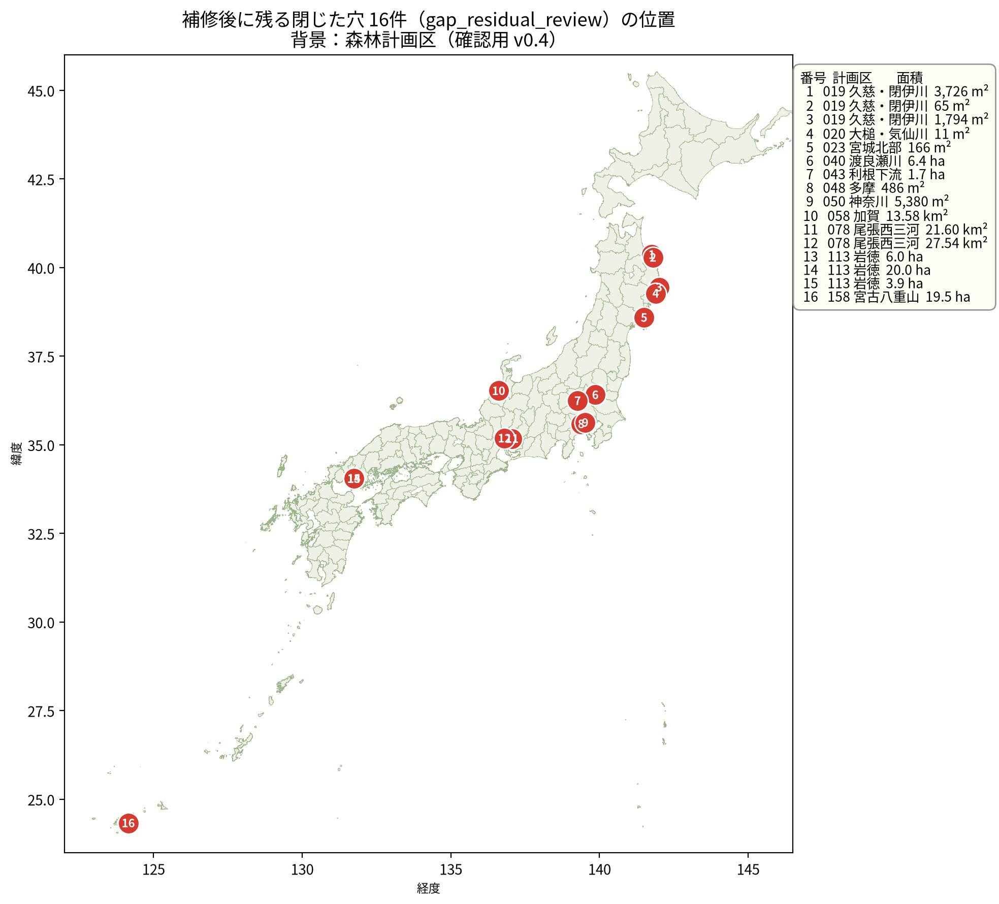
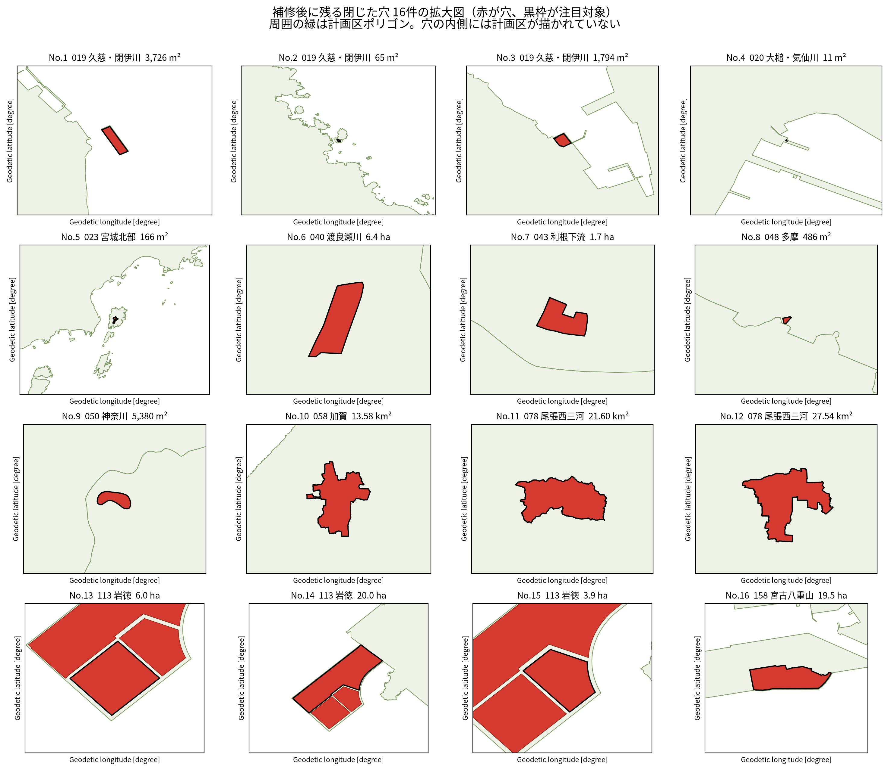
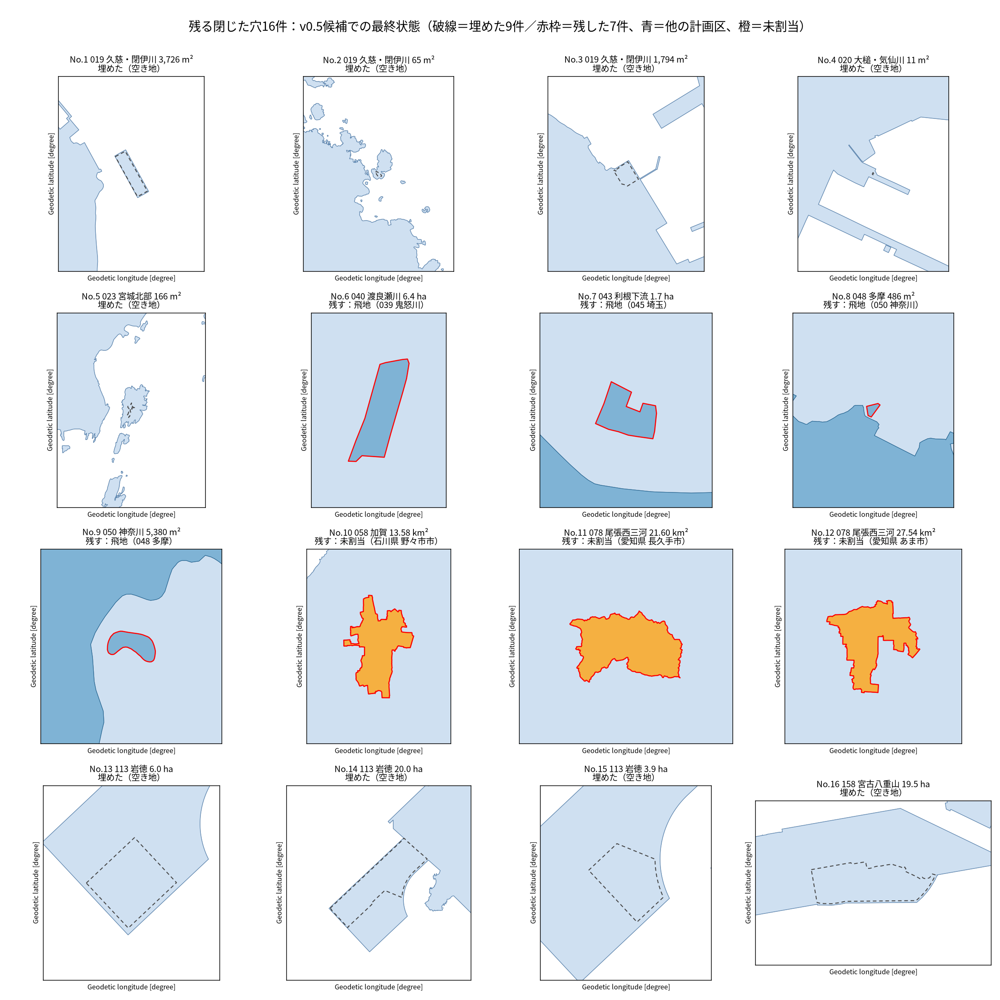
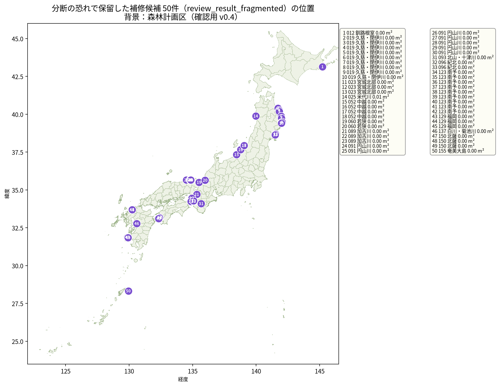
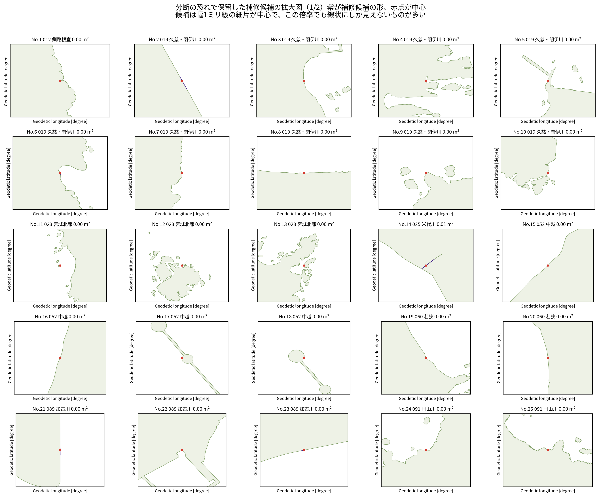
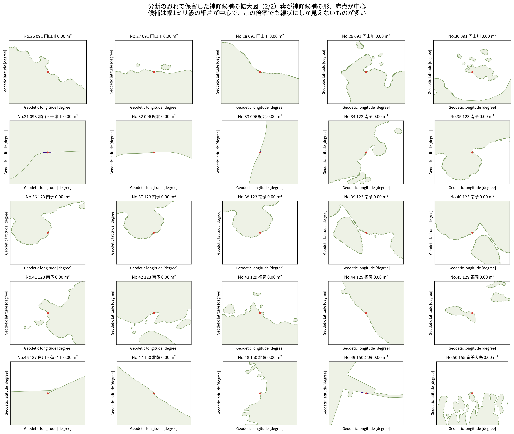
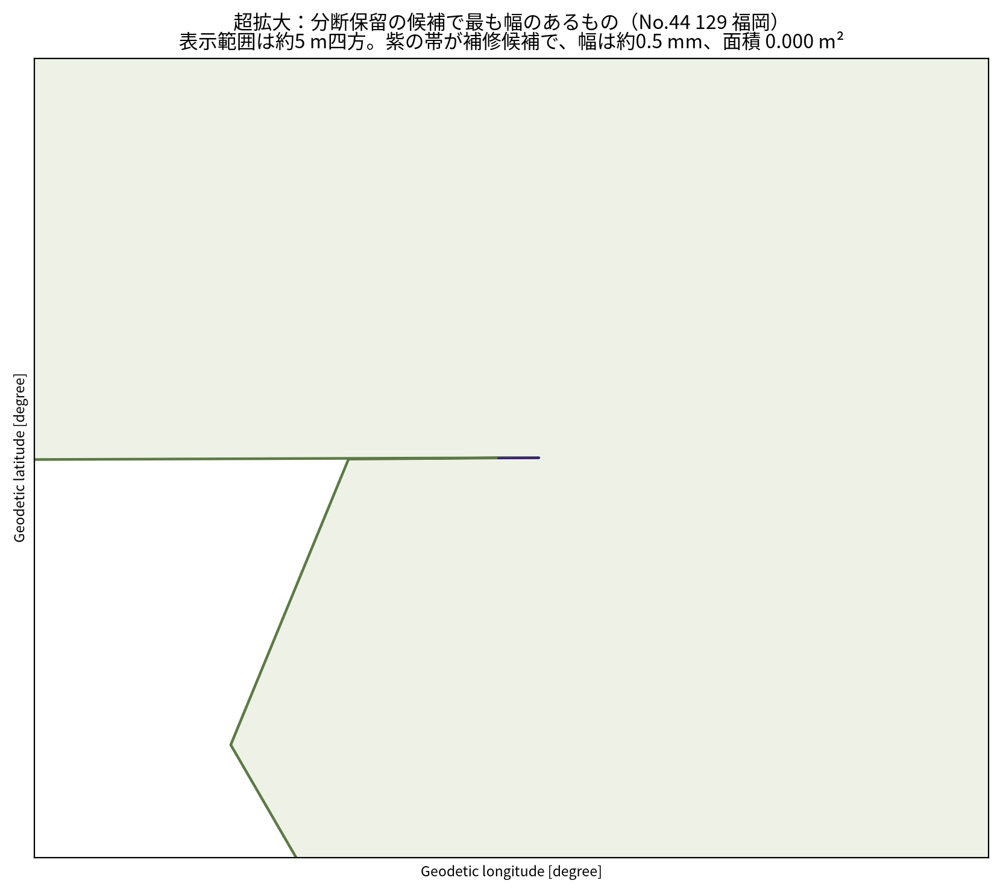
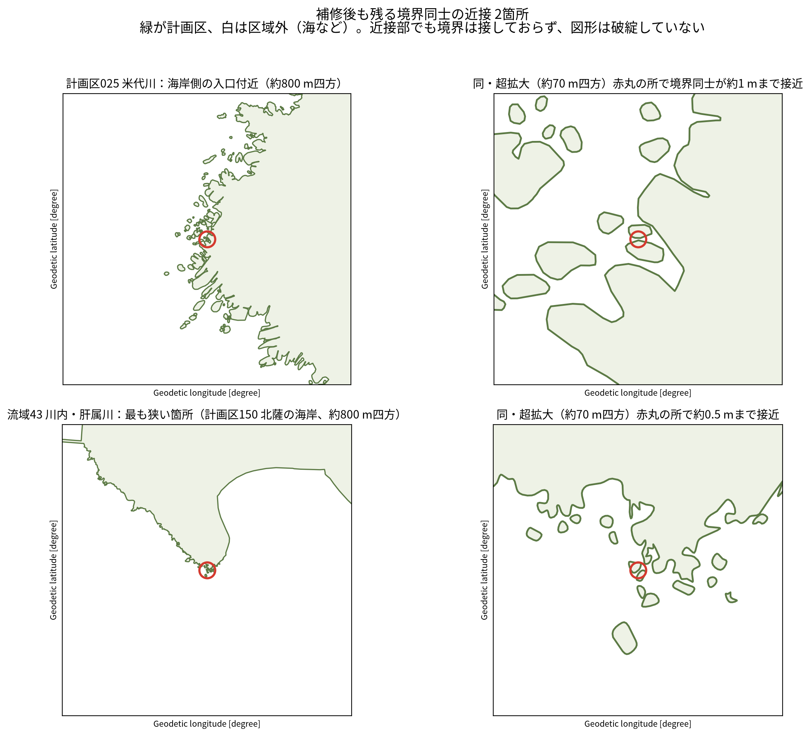

# 残る閉じた穴16件の分類と処置、分断保留50件の掃除、近接2箇所の記録（2026-11-06）

## 概要

確認用 v0.4 の補修で残った「閉じた穴」16件（`gap_residual_review` レイヤー）について、計画区レイヤーだけでなく未割当レイヤーや隣接する計画区と重ねて調べたところ、**本当に空き地だったのは9件だけ**でした。残りの7件は、穴の内側に実体がありました。

- 4件は、隣の計画区の飛地でした。
- 3件は、未割当（未割当・要照会）の区域そのものでした。

このため、16件すべてを埋める処置は取りやめ、空き地の9件だけを埋めた候補（v0.5候補）を作り直しました。あわせて、補修で分断のおそれがあるとして保留していた微細な断片50件の掃除も、この候補に適用しました。

本データでは、形状の微細な乱れを整えたうえで公開しています。飛び地や、行政界の割当のない未所属地は、実在の状態としてそのまま収録しています。

この記録の処置を反映した候補は、確認用 v0.5 として 2026-11-09 に公開しました（Release `review-v0.5-20261109`）。公開済みの v0.4 は変更していません。データの位置づけはこれまでどおり「確認用・区域未確定」です。

## 16件の分類と処置

| No. | 計画区 | 面積 | 分類 | 内側の実体 | 処置 |
|---:|---|---:|---|---|---|
| 1 | 019 久慈・閉伊川 | 3,726 m² | 空き地 | なし | 埋めた |
| 2 | 019 久慈・閉伊川 | 65 m² | 空き地 | なし | 埋めた |
| 3 | 019 久慈・閉伊川 | 1,794 m² | 空き地 | なし | 埋めた |
| 4 | 020 大槌・気仙川 | 11 m² | 空き地 | なし | 埋めた |
| 5 | 023 宮城北部 | 166 m² | 空き地 | なし | 埋めた |
| 6 | 040 渡良瀬川 | 6.4 ha | 飛地 | 039 鬼怒川（重なり 64,278 m²、内側全域） | 残す |
| 7 | 043 利根下流 | 1.7 ha | 飛地 | 045 埼玉（重なり 16,711 m²、内側全域） | 残す |
| 8 | 048 多摩 | 486 m² | 飛地 | 050 神奈川（重なり 486 m²、内側全域） | 残す |
| 9 | 050 神奈川 | 5,380 m² | 飛地 | 048 多摩（重なり 5,365 m²、内側ほぼ全域） | 残す |
| 10 | 058 加賀 | 13.58 km² | 未割当 | 石川県 野々市市 | 残す |
| 11 | 078 尾張西三河 | 21.60 km² | 未割当 | 愛知県 長久手市 | 残す |
| 12 | 078 尾張西三河 | 27.54 km² | 未割当 | 愛知県 あま市 | 残す |
| 13 | 113 岩徳 | 6.0 ha | 空き地 | なし | 埋めた |
| 14 | 113 岩徳 | 20.0 ha | 空き地 | なし | 埋めた |
| 15 | 113 岩徳 | 3.9 ha | 空き地 | なし | 埋めた |
| 16 | 158 宮古八重山 | 19.5 ha | 空き地 | なし | 埋めた |

面積は `gap_residual_review` の記録値です。重なり面積は EPSG:6933 による測地系面積です。

最終状態の図では、埋めた9件を破線で示しています。残した7件は赤枠で示し、内側の実体を色で描いています（青が他の計画区、橙が未割当）。

## 飛地の4件について

No.6 は、渡良瀬川計画区の内側に鬼怒川計画区の飛地が入っているものです。No.7 は、利根下流計画区の内側に埼玉計画区の飛地が入っているものです。どちらも内側全域が相手側の計画区と重なっていました。

No.8 と No.9 は、多摩川沿いで多摩計画区と神奈川計画区の境界が入り組んだ箇所で、互いの内側に相手側の土地が入っているものです。

これら4件を「穴」として埋めると、相手側の計画区の土地を取り込む形になり、計画区同士の重なりが生じます。そのため、埋めずに残しています。飛地であること自体の是非は、原典資料に基づく所属の確定の話であり、このデータの範囲では判断しません。

## 未割当の3件について

No.10 から No.12 は、計画区に囲まれた市そのものが未割当になっているものです。いずれも市域のほぼ全域が計画区未割当（未割当・要照会）の区域と一致していました。

- No.10：石川県 野々市市（加賀計画区に囲まれています）
- No.11：愛知県 長久手市（尾張西三河計画区に囲まれています）
- No.12：愛知県 あま市（尾張西三河計画区に囲まれています）

3件の合計は約 62.6 km² です。未割当の区域を計画区の穴として埋めると、所属が決まっていない土地を計画区に二重に割り当てることになります。そのため、埋めずに未割当のまま残しています。所属の確定は、権威ある資料が出たときの話です。

## 空き地の9件の埋め方

空き地の9件は、他のどの計画区とも、未割当の区域とも重ならないことを確認したうえで、計画区ポリゴンの内側の輪（リング）を取り除く方法で埋めました。埋めたことによる面積の増分は記録面積とおおむね一致し、差は最大でも1%未満で、面積を測る座標系の違いによる差の範囲でした。変更のあった計画区が所属する流域は、所属計画区の和集合で再集約しました。

## 分断保留50件の掃除

補修台帳（`gap_repair_audit`、6,895件）のうち、補修すると図形が分断するおそれがあるとして保留していた50件（decision が `review_result_fragmented` のもの）は、いずれも境界線や海岸線の上の微細な断片でした。実測では、全件とも面積は実質ゼロで、最も大きなものでも記録 0.01 m² でした。最も幅のある断片でも、幅は約 0.5 mm、長さは約 43 cm でした。

掃除は、断片だけを 2 mm 膨らませ、隣接する計画区と重なる部分を切り取ってから、計画区に合成する方法で行いました（計画区の形状そのものは変換していません）。1件ずつ、合成しても図形が分断しないこと、元の形が欠けないこと、断片が計画区に取り込まれること、変更が断片の周辺にとどまることを機械的に確認し、50件すべてで確認が取れました。全国での面積の増加は合計 0.258 m²（最大でも1件あたり 0.068 m²）で、無効な形状は生じていません。

なお、掃除の最初の実装では、計画区全体を投影座標系に変換して合成したため、隣の計画区との間に 0.037 m² の重なりが生じました。このため、上記の方法に直して候補を作り直しています。最終の候補では、後述の検証のとおり、新たな重なりは生じていません。

## 近接の2箇所について

図形同士が目に見えて近づいている箇所として、次の2箇所を記録します。どちらも島や海岸の断片同士が近づいているもので、誤りではないと判断し、そのまま残しています。

- 計画区 025 米代川の海岸側の入口付近：境界同士が約 1.0 m まで近づく箇所が、海岸の入り組み一帯（能代付近）に複数あります。
- 流域 43 川内・肝属川：流域の輪郭で最も狭い箇所は、計画区 150 北薩の岬の先端で約 0.5 m でした。ほかにも島と海岸の流域ゆえの近接が複数あります。

## v0.5候補の検証結果

作り直した候補を v0.4 とつき合わせて全数で検証しました。すべての項目が合格でした。

- 件数は、計画区158、広域流域44、未割当20、補修台帳6,895で v0.4 と一致し、残る閉じた穴は16件から7件になりました。
- 全レイヤーで、無効な形状は0件でした。
- 計画区同士の重なりは合計 0.0004 m²（最も大きいペアでも 0.00005 m²）で、v0.4 を同じ方法で測った値と一致しました。今回の処置で新たに生じた重なりはありません。この微小な重なりは原データ由来のもので、v0.4 にも同じだけあります。
- 計画区と未割当の重なりは 0 m² でした。
- 埋めた9件は、いずれも自分の計画区に覆われるようになりました。残した7件は、いずれも自分の計画区の穴のままです。
- 残る閉じた穴のレイヤーは、残した7件と一致しました。
- 変更のなかった計画区140件は、v0.4 と形状が完全に一致しました。変更した18計画区には、いずれも差分がありました。
- 流域44件は、いずれも所属する計画区の和集合と一致しました。変更の影響のなかった流域は、v0.4 と完全に一致しました。
- 未割当と補修台帳のレイヤーは変更していません。

## 残る話

- 残した7件のうち、飛地の4件と未割当の3件は、所属の確定に関わる話です。このデータでは「確認用・区域未確定」の位置づけのまま残します。
- v0.5候補の公開は別途判断します。
